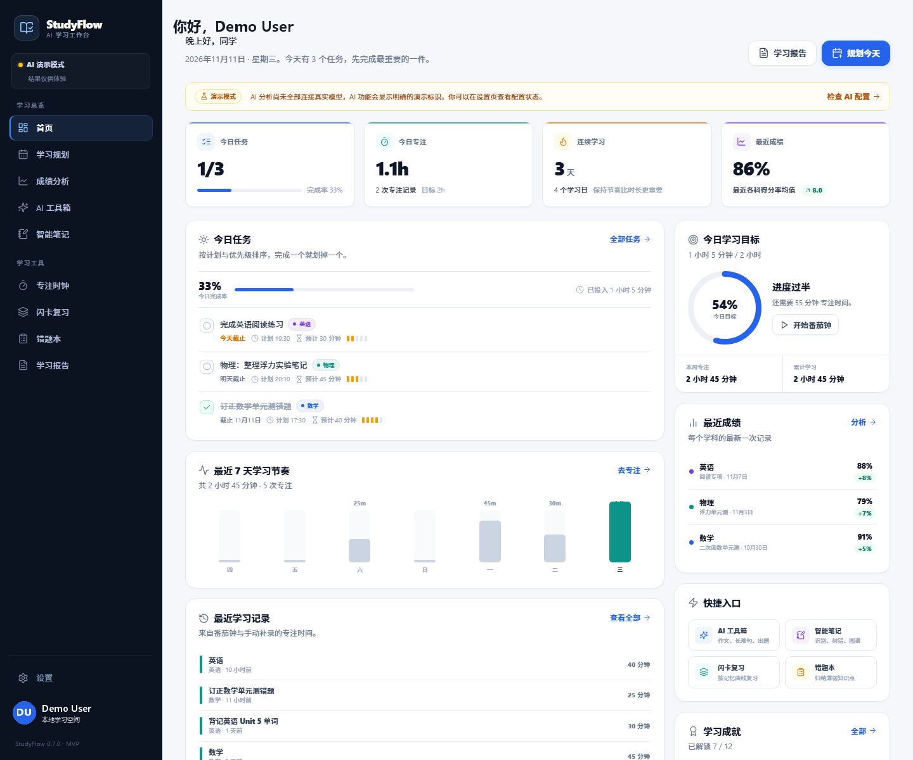
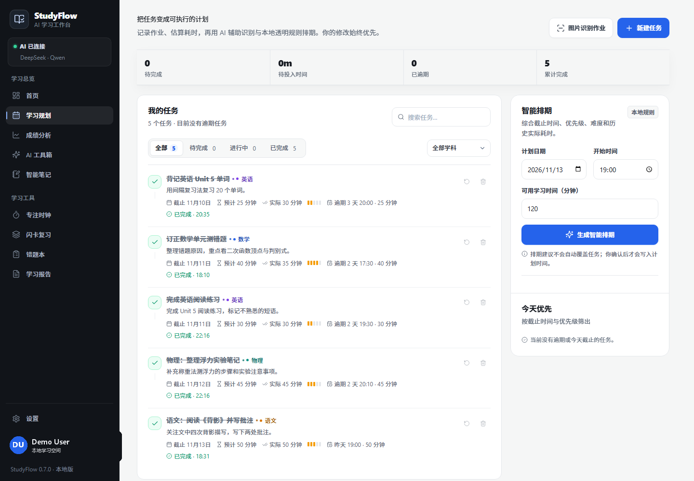
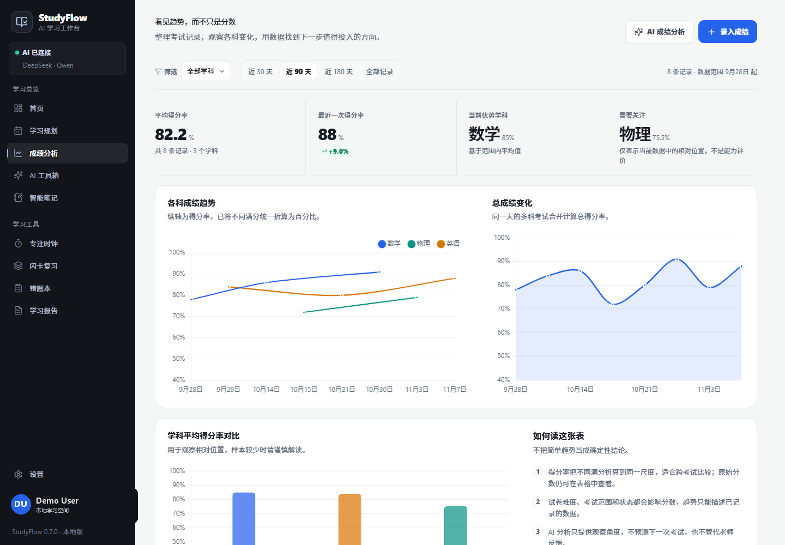
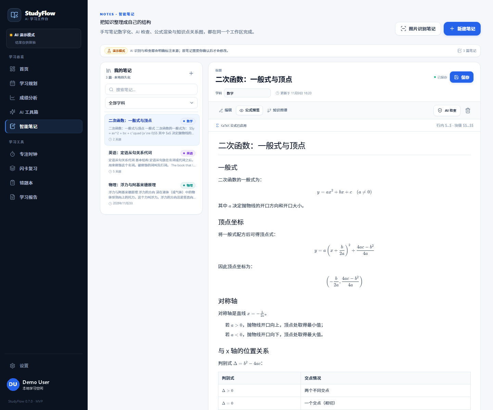
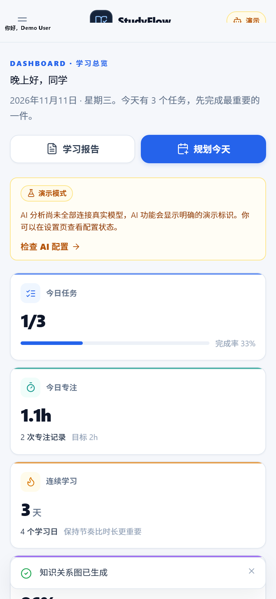
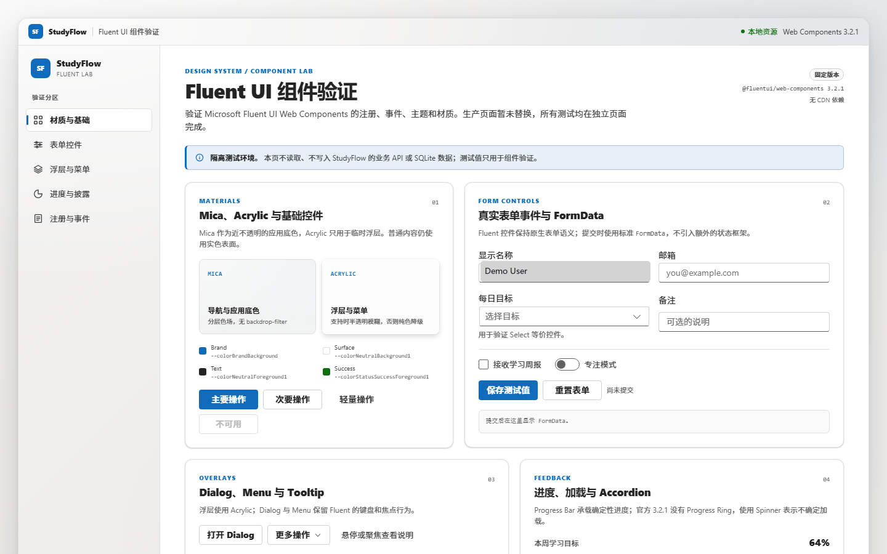
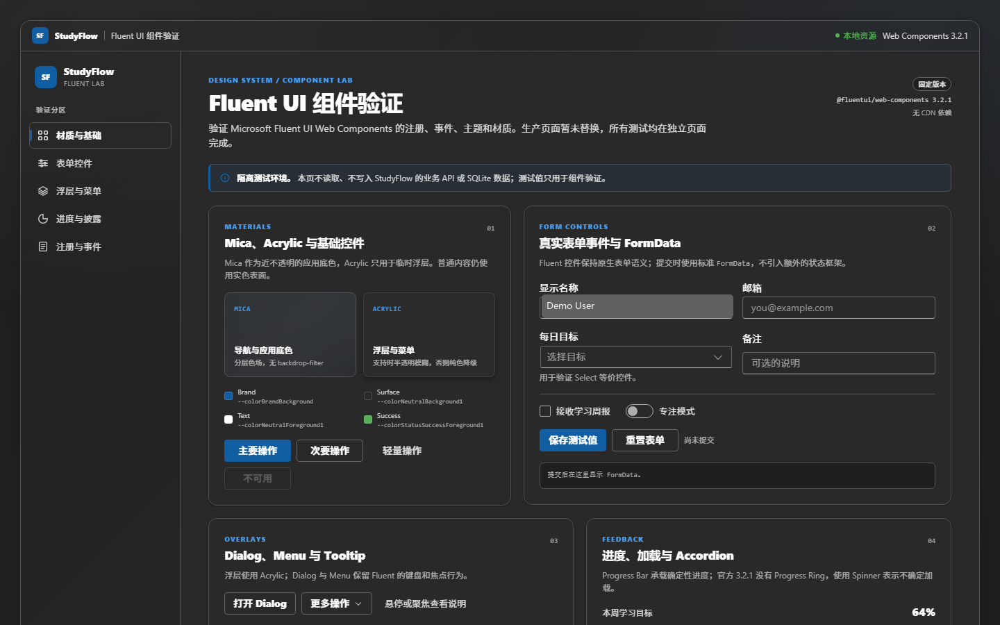
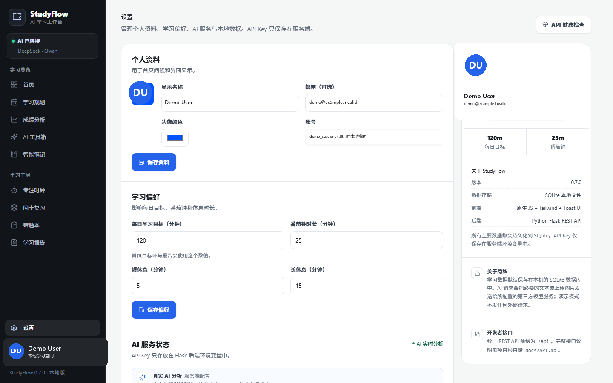
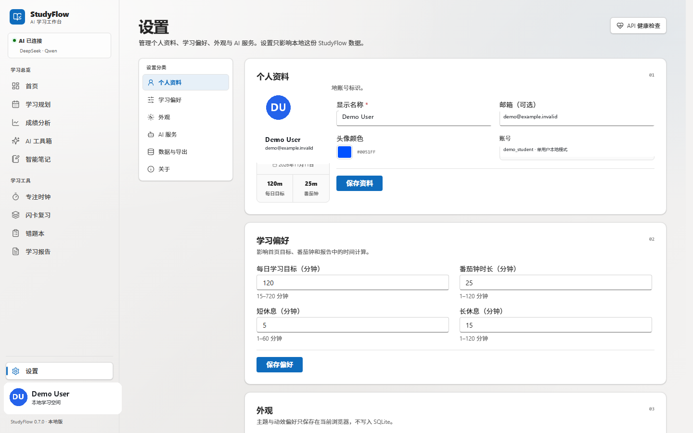

# StudyFlow

> 当前发布版本：`1.1.0`
>
> AI 智能学习管理平台 · MVP（约 70% 完成度）

StudyFlow 是一个面向中学生的全栈学习工作台：把作业规划、成绩分析、英语 AI 工具、笔记数字化、专注计时、闪卡复习和每日报告放进同一个轻量应用。

前端是原生 HTML / CSS / JavaScript（ES Modules）+ Tailwind 工具类，后端是 Python Flask + SQLite。项目不依赖 React、Vue、Next.js，也没有 Node 构建步骤。



---

## 目录

- [当前完成度](#当前完成度)
- [功能总览](#功能总览)
- [技术栈](#技术栈)
- [快速开始](#快速开始)
- [环境变量](#环境变量)
- [AI 配置与演示模式](#ai-配置与演示模式)
- [项目结构](#项目结构)
- [数据库设计](#数据库设计)
- [测试与验证](#测试与验证)
- [已知限制与未实测项](#已知限制与未实测项)
- [后续开发接口](#后续开发接口)
- [常见问题](#常见问题)
- [API 文档](docs/API.md)
- [安全政策](SECURITY.md)
- [部署与运维](docs/DEPLOY_DEBIAN_ARM64.md)
- [UI 设计系统](docs/UI_DESIGN_SYSTEM.md)

---

## 当前完成度

这是可运行的核心 MVP，不是静态原型：

- ✅ 6 个主页面 + 专注/闪卡/错题/报告 4 个学习工具页面，真实 hash 导航
- ✅ 任务规划、AI 图片作业识别、本地透明排期、历史任务
- ✅ 成绩 CRUD、3 种 Chart.js 图表、科目/时间范围筛选、AI 成绩分析（含演示标识）
- ✅ 英语作文批改、表达润色、长难句、语法诊断、出题、阅卷
- ✅ 笔记 CRUD、Toast UI 编辑、图片识别草稿、AI 检查、KaTeX 预览、Cytoscape 知识图
- ✅ 番茄钟、手动学习记录、学习成就、闪卡生成与间隔复习、错题知识点归类、每日报告
- ✅ 多用户邮箱账户：注册、邮箱验证、邮箱登录、Session 绑定与按用户数据隔离
- ✅ 访客模式：浏览器 IndexedDB 本地存储、明确确认后导入账户、访客 AI 禁用
- ✅ 统一 REST API / 统一 AI Service / JSON 校验 / 有限重试 / 明确错误语义
- ✅ SQLite 持久化、演示数据可载入/清除、JSON 导出
- ✅ 后端 pytest 测试、GitHub Actions CI、浏览器自动化联调（桌面 + 390px 移动端）
- ✅ 已使用本地 `.env` 真实凭据完成 Qwen 视觉（含图片）与 DeepSeek 文本连通性测试；Key 不写入代码、日志或版本库
- 🎨 十个生产页面已完成 Fluent 设计系统迁移；Fluent 2 tokens、Mica/Acrylic、全站浅/深色主题、本地固定资源

---

## 功能总览

| 页面 | 已经实现的核心能力 |
| --- | --- |
| **Dashboard 首页** | 问候语、今日日期、今日任务完成率、学习时长、7 天节奏、最近成绩、最近学习记录、快捷入口、成就、演示模式提示 |
| **Planner 学习规划** | 手动任务 CRUD、完成/重开/开始、历史任务、实际耗时、截止日期、难度/优先级、图片识别作业草稿、智能排期预览与应用 |
| **Analytics 成绩分析** | 成绩 CRUD、考试日期/分数/满分/备注、按学科与时间筛选、各科折线图、总成绩变化图、学科平均对比、AI 分析 |
| **AI Toolbox** | 作文批改（文本/图片）、表达润色（三版本）、长难句、语法诊断、AI 出题、AI 阅卷 |
| **Notes 智能笔记** | Markdown 笔记 CRUD、Toast UI Editor、图片笔记识别、AI 检查（确定/待确认/可信度）、KaTeX 预览、Cytoscape 交互知识图谱 |
| **Focus 专注时钟** | 自定义番茄钟、短/长休息、暂停/继续/重置、完成后自动记录学习时长、手动补录、今日记录、成就墙 |
| **Flashcards 闪卡** | 手动 CRUD、从笔记 AI 生成、翻面复习、1/3/5 评分、掌握度与下次复习日期、到期队列 |
| **Errors 错题本** | 错题 CRUD、知识点标签、掌握状态、答案/错因折叠、AI 学科与知识点归类建议 |
| **Reports 学习报告** | 按日期查看本地学习汇总、目标进度、任务回顾、学科投入、时间线、建议、打印 |
| **Settings 设置** | Fluent 重设计；昵称/资料邮箱/头像色、目标/番茄钟时长、AI 服务状态、环境变量说明、演示数据载入/清除、JSON 导出、浅/深色主题、跟随系统、减少动画。资料邮箱与登录邮箱不是同一个字段，登录邮箱不在此页修改 |

### 页面预览

| 学习规划 | 成绩分析 |
| --- | --- |
|  |  |

| 智能笔记 + KaTeX | 知识关系图 |
| --- | --- |
|  |  |

| AI 工具箱 | 移动端 |
| --- | --- |
|  |  |

### Fluent UI 组件实验室（实验，不是生产页面）

已引入固定版本 `@fluentui/web-components@3.2.1`，资源保存在本地，不依赖 CDN、React 或 Vue。独立测试页验证了 Mica / Acrylic、Fluent 2 tokens、表单 FormData、Dialog、Menu、Tooltip、Progress Bar、Spinner 与响应式布局。

- 本地地址：`http://127.0.0.1:5000/lab/fluent-lab.html`
- 集成说明：`docs/FLUENT_UI_INTEGRATION.md`
- 全部十个生产页面已完成 Fluent 设计系统迁移；Settings 为已验收基准。
- 全站迁移说明与九页前后截图：`docs/ALL_PAGES_FLUENT_MIGRATION.md`
- Settings 基准说明：`docs/SETTINGS_FLUENT_MIGRATION.md`

| Fluent Lab · Light | Fluent Lab · Dark |
| --- | --- |
|  |  |

| Settings Before | Settings After |
| --- | --- |
|  |  |

---

## 技术栈

**前端**

- HTML5、CSS3 自定义设计变量、原生 JavaScript（ES Modules，无框架）
- Tailwind CSS 浏览器版本（已本地化到 `frontend/vendor/tailwind.min.js`，作为 utility 辅助；视觉组件由 `css/` 中的样式系统统一）
- Chart.js 4 —— 成绩图表
- Cytoscape.js 3 —— 知识图谱
- Toast UI Editor 3 —— Markdown 笔记编辑
- KaTeX —— 数学公式渲染（配合 marked + DOMPurify）
- Lucide —— 图标

**后端**

- Python 3.10+
- Flask 3 + flask-cors + python-dotenv
- SQLite（`sqlite3` 标准库，开启外键、索引、WAL）
- requests —— 调用 OpenAI-compatible 的 DeepSeek / Qwen 接口
- Pillow —— 上传图片真实性校验、压缩与元数据清理
- pytest —— API / AI 网关 / 演示数据测试

所有前端第三方库都已下载到 `frontend/vendor/`，运行时**不需要外网 CDN**（真实 AI 调用除外）。KaTeX 字体也已本地化。

---

## 快速开始

### 1. Python 环境

建议 Python **3.10 及以上**。在项目根目录执行：

**Windows（cmd / PowerShell）**

```bat
python -m venv .venv
.venv\Scripts\activate
pip install -r requirements.txt
copy .env.example .env
python scripts/hash_password.py
python run.py
```

启动前必须把随机生成的 `SECRET_KEY` 和 `STUDYFLOW_PASSWORD_HASH` 写入 `.env`；缺少时应用会拒绝启动。`STUDYFLOW_PASSWORD_HASH` 用于启动校验和旧数据库的过渡登录，不是新用户的正常登录方式；新用户通过邮箱注册并完成验证。

**macOS / Linux**

```bash
python3 -m venv .venv
source .venv/bin/activate
pip install -r requirements.txt
cp .env.example .env
python scripts/hash_password.py
python run.py
```

启动前必须把随机生成的 `SECRET_KEY` 和 `STUDYFLOW_PASSWORD_HASH` 写入 `.env`；缺少时应用会拒绝启动。`STUDYFLOW_PASSWORD_HASH` 用于启动校验和旧数据库的过渡登录，不是新用户的正常登录方式；新用户通过邮箱注册并完成验证。

打开 <http://127.0.0.1:5000>。首次使用请打开 <http://127.0.0.1:5000/login?mode=register> 创建邮箱账户；本地默认 `MAIL_BACKEND=console`，验证链接会打印在后端终端，而不会真的发邮件。要接收真实验证邮件，请按[部署说明](docs/DEPLOY_DEBIAN_ARM64.md)配置 SMTP。

如果不想手动敲命令，Windows 可双击/执行：

```bat
start.bat
```

macOS/Linux：

```bash
chmod +x start.sh
./start.sh
```

PowerShell：

```powershell
powershell -ExecutionPolicy Bypass -File .\start.ps1
```

> 启动脚本会优先使用 `.venv` 中已安装 Flask 的 Python，其次才尝试 `py -3` / `python`。如果依赖缺失，会给出安装命令提示，不会静默启动失败。

### 2. 数据库初始化

正常情况下不需要额外步骤：`run.py` 启动时会自动执行幂等的 `backend/schema.sql`，创建表、索引、共享登录限流表和旧数据兼容用户。已有数据库不会被清空。

也可以手动初始化（可查看表记录数）：

```bash
python scripts/init_db.py
```

可用参数：

```bash
python scripts/init_db.py --no-seed
python scripts/init_db.py --reload-demo
```

`.env.example` 默认 `SEED_DEMO=false`，不会写入演示数据；若完全不设置该变量，代码层默认值是 `true`，因此生产环境应显式设为 `false`。仅本地开发需要演示数据时才设为 `true`；清除演示数据不会删除用户自己创建的内容。初始化前必须已经配置 `.env` 中的认证参数。

### 3. 访问

| 地址 | 说明 |
| --- | --- |
| <http://127.0.0.1:5000/login> | 邮箱登录页（公开）；`?mode=register` 打开注册 |
| <http://127.0.0.1:5000/guest> | 访客模式确认页（公开；不创建服务端账户） |
| <http://127.0.0.1:5000/verify-email?token=...> | 邮箱验证链接（公开） |
| <http://127.0.0.1:5000> | 应用首页，未登录会跳转登录页 |
| <http://127.0.0.1:5000/api/health> | 健康检查（需要登录） |
| <http://127.0.0.1:5000/api/meta> | 应用与 AI 配置状态（需要登录） |
| <http://127.0.0.1:5000/api/*> | REST API 前缀；`/api/auth/*` 公开，其余需要 Session |

## 邮箱账户、认证与访客模式

**正式账户**

- 账户以邮箱为主要登录标识；注册后必须通过邮件中的验证链接，未验证账户不能登录。
- 注册密码至少 12 个字符（由 `PASSWORD_MIN_LENGTH` 控制），服务端只保存 scrypt 哈希。
- 登录使用 `POST /api/auth/login` 或 `/login` 表单；成功后才建立 Flask Session。
- 所有业务数据、AI 接口和 `/uploads/*` 文件都按当前 Session 的 `user_id` 隔离；没有“管理员可以查看全部用户数据”的接口。
- 每个 `users` 行通过 `auth_accounts` 一对一关联登录邮箱。设置页可编辑资料邮箱，但**不会修改登录邮箱**。
- Session Cookie 使用 HttpOnly、可配置 SameSite；HTTPS 部署后应设置 `SESSION_COOKIE_SECURE=true`。Session 默认 12 小时过期，登录会清空旧 Session。
- 写请求要求同源 `Origin/Referer`，作为 SameSite 之外的 CSRF 防护。
- 登录失败按来源 IP 和邮箱计数，默认 5 次/15 分钟；计数表由 SQLite 共享，多个 Gunicorn Worker 使用同一份计数。
- 注册、登录、重发验证和 API 验证的请求/响应见 [API 文档](docs/API.md)。

**过渡兼容**

`STUDYFLOW_PASSWORD_HASH` 仍是启动时的必填安全配置。当数据库里还没有任何邮箱账户时，旧登录表单/API 可用这个密码哈希做过渡登录；一旦创建了邮箱账户，该入口不再生效。这不是新用户的正常注册/登录流程，也不应在文档或产品界面中宣传为管理员账户体系。

如果旧数据库中的现有业务数据需要归属到某个邮箱账户，必须在备份并验证后显式运行 `scripts/migrate_iteration1.py --admin-email ...`；仅启动应用只会幂等创建新增表，不会自动更改旧数据的 `user_id` 或把旧资料绑定到新账户。

**访客模式**

- `/guest` 会先展示确认页；确认后清除正式 Session，SPA 以 `window.__STUDYFLOW_GUEST__` 运行。
- 访客业务数据只写入浏览器 IndexedDB（`studyflow-guest`），不会发送到服务端，也没有云端账户、跨设备同步或服务端备份。
- 清除浏览器站点数据、换浏览器或换设备都可能丢失访客数据。
- 访客模式不开放 AI 工具（前端本地返回 `GUEST_AI_DISABLED`，直接请求服务端 AI 也会因没有 Session 返回 401）；也不提供演示数据载入。
- 登录正式账户后，如果当前浏览器仍有访客数据，应用会弹窗列出数量并询问是否导入；只有用户点击确认后才会调用 `POST /api/guest/import`。导入按当前 Session 的用户执行，忽略客户端伪造的 `user_id`，按批次和本地记录 UID 幂等，不覆盖已有账户记录；导入后本地访客数据仍保留。

**配置文件与旧密码**

- 旧密码哈希通过 `python scripts/hash_password.py` 生成，明文不落盘；不要把它与普通用户密码混用。
- 生产部署、SMTP、HTTPS 与备份见 [Debian ARM64 部署说明](docs/DEPLOY_DEBIAN_ARM64.md)。

本地数据默认位于：

```text
data/studyflow.db
data/uploads/
```

---

## 环境变量

复制 `.env.example` 为 `.env`。后端在启动时读取 `.env`；前端无法读取这些值，API Key 永远不会发送到浏览器。

| 变量 | 默认 | 说明 |
| --- | --- | --- |
| `HOST` | `127.0.0.1` | Flask 监听地址 |
| `PORT` | `5000` | Flask 端口 |
| `FLASK_ENV` | `production` | 不要用 development/debug 对外提供服务 |
| `SECRET_KEY` | 无默认值 | **必填**；至少 32 位随机值 |
| `STUDYFLOW_PASSWORD_HASH` | 无默认值 | **必填**；启动校验与旧库过渡登录兼容；新用户不使用它登录 |
| `SESSION_COOKIE_SAMESITE` | `Lax` | `Lax` / `Strict` / `None` |
| `SESSION_COOKIE_SECURE` | `false` | HTTPS 部署后设为 `true` |
| `SESSION_LIFETIME_HOURS` | `12` | 登录会话最长有效时间 |
| `LOGIN_MAX_ATTEMPTS` | `5` | 共享登录限流允许的失败次数 |
| `LOGIN_WINDOW_SECONDS` | `900` | 登录失败固定窗口秒数 |
| `MAIL_BACKEND` | `console` | `console` 仅本地开发；生产使用 `smtp` |
| `MAIL_FROM` | `StudyFlow <no-reply@localhost>` | 验证邮件发件人 |
| `PUBLIC_BASE_URL` | `http://127.0.0.1:5000` | 验证链接的公开基地址；生产必须是 HTTPS 外部地址 |
| `EMAIL_VERIFICATION_HOURS` | `24` | 验证链接有效期 |
| `PASSWORD_MIN_LENGTH` | `12` | 新账户密码最小长度 |
| `SMTP_HOST` | 空 | SMTP 主机；生产必填 |
| `SMTP_PORT` | `587` | SMTP 端口 |
| `SMTP_USERNAME` | 空 | SMTP 登录名；为空则不登录 |
| `SMTP_PASSWORD` | 空 | SMTP 密码；只放 `.env` |
| `SMTP_USE_TLS` | `true` | 非 SSL 连接使用 STARTTLS |
| `SMTP_USE_SSL` | `false` | 使用 SMTPS/465；与 STARTTLS 二选一 |
| `TRUST_PROXY` | `false` | 仅在可信反向代理后设为 `true` |
| `TIMEZONE` | `Asia/Shanghai` | 日期、今日统计使用 |
| `DATABASE_PATH` | `data/studyflow.db` | 相对项目根目录 |
| `UPLOAD_DIR` | `data/uploads` | 上传目录 |
| `SEED_DEMO` | 代码默认 `true`，示例配置 `false` | 生产必须显式设为 `false` |
| `CORS_ORIGINS` | 空 | 需要跨域时填写允许的前端源，逗号分隔 |
| `AI_DEMO_MODE` | `auto` | `auto` / `on` / `off`，见下文 |
| `AI_TIMEOUT` | `60` | 请求 AI 的超时秒数 |
| `AI_MAX_RETRIES` | `2` | JSON/网络类错误的自动重试次数（不含首次） |
| `AI_TEXT_MODEL` | `deepseek-chat` | DeepSeek 文本模型 |
| `AI_VISION_MODEL` | `qwen3.8-flash` | Qwen 视觉模型（必须支持图片输入） |
| `AI_VISION_BASE_URL` | 无默认值 | 必须由 `.env` 提供百炼 OpenAI 兼容接口地址 |

---

## AI 配置与演示模式

### 文本模型（DeepSeek 或任意 OpenAI 兼容接口）

```dotenv
AI_TEXT_PROVIDER=deepseek
AI_TEXT_API_KEY=your_key_here
AI_TEXT_BASE_URL=https://api.deepseek.com/v1
AI_TEXT_MODEL=deepseek-chat
```

### 视觉模型（Qwen 3.8 Flash / 阿里云百炼，OpenAI 兼容模式）

```dotenv
AI_VISION_PROVIDER=qwen
AI_VISION_API_KEY=your_key_here
AI_VISION_BASE_URL=https://dashscope.aliyuncs.com/compatible-mode/v1
AI_VISION_MODEL=qwen3.8-flash
```

`AI_VISION_BASE_URL` **没有后端默认值**，必须由 `.env` 提供；代码中不再硬编码百炼地址。`AI_VISION_API_KEY` 只从服务端环境变量读取。

图片识别链路会先在服务端读取上传文件并编码为 Base64 data URL，再以 OpenAI 兼容的多模态消息发送：

```json
{"type": "image_url", "image_url": {"url": "data:image/png;base64,..."}}
```

本地文件路径不会作为普通文本发给模型。`qwen3.8-flash` 必须在该百炼账号中支持视觉输入；若供应商账号未开放此模型或多模态能力，API 会返回明确的拒绝/鉴权错误，不会静默切换模型。

### 三种运行策略

| `AI_DEMO_MODE` | 行为 |
| --- | --- |
| `auto`（默认） | 有对应 Key → 调用真实模型；没有 → 明确标记的本地演示模式 |
| `on` | 始终演示；不发起任何外部 AI 请求 |
| `off` | 严格模式；没有 Key 时返回 `503 AI_NOT_CONFIGURED`，不偷偷演示 |

所有 AI 响应都包含 `ai.mode = live | demo`、真实或演示 provider、notice 与 disclaimer。前端在结果区显示「演示模式 · 非真实模型结果」或「真实 AI 分析」。

演示模式的行为是透明的：

- 不声称读取了图片：任务/笔记图片识别返回 `confidence: 0.0` 和警告；
- 对用户自己的文本（作文、语法、句子）使用本地启发式规则，并标注不是模型结果；
- 成绩分析和笔记检查会明确说明检查范围有限；
- 不会自动修改用户数据；所有应用/保存都需要用户确认。

### AI Service 设计

`backend/services/ai_service.py` 统一处理：

- 文本 / 视觉能力、model/base URL/key 的配置读取；Qwen 的 Base URL 无代码默认值，必须来自环境变量；
- OpenAI-compatible `/chat/completions` 请求；
- Qwen 视觉请求使用 `image_url` 多模态内容块，图片以 Base64 data URL 传输，不把本地路径当文本；
- JSON 提取（支持代码围栏、前缀文本）、字段归一化回调校验；
- JSON 格式错误有限次重试及反馈；
- 超时、限流、5xx、鉴权、请求拒绝、配置不完整的语义化错误；
- AI HTTPS 请求使用 `truststore` 读取操作系统 CA 库（保持证书校验），兼容企业/校园网络的自签拦截链；
- 返回提供方实际模型标识（`usage.response_model`）用于诊断，不把 Key 暴露到响应/日志/错误消息。

`backend/services/ai_features.py` 是业务门面：每个工具拥有独立的 prompt、输出归一化与演示实现。真实模型的异常输出不会直接进入前端，必须先过归一化。

### 真实 API 连通性测试

配置好 `.env` 后，可运行可选的、会产生真实计费请求的连通性测试：

```bash
# 默认：测试 Qwen 端点连通性，成功后自动生成测试图并验证多模态图片输入
python scripts/test_ai_connection.py

# 同时测试 DeepSeek 文本与 Qwen 视觉
python scripts/test_ai_connection.py --capability all
```

脚本的行为：

1. 检查 Key、`AI_VISION_BASE_URL`、模型名和 `AI_DEMO_MODE`，缺项时不发请求；
2. 第一步向 Qwen 端点发送纯文本 JSON 往返请求，验证鉴权、模型名与接口地址；
3. **只有连通性成功后**，才在内存中生成一张“白底红色圆形”PNG，以 data URL 发送并校验模型对形状/颜色的 JSON 识别；
4. 只输出脱敏后的配置和模型名称，绝不打印 API Key；
5. 退出码：`0` 全部通过，`1` 请求/校验失败，`2` 缺少凭据或演示模式阻止了真实调用。

脚本详细说明见 [`scripts/test_ai_connection.py`](scripts/test_ai_connection.py)。若没有 Key，它会返回 `2` 并明确标注未进行真实调用。

---

## 项目结构

```text
studyflow/
├── backend/
│   ├── app.py                 # Flask factory、静态前端、API 错误处理、蓝图注册
│   ├── accounts.py            # 邮箱注册、验证、登录校验
│   ├── auth.py                # Session、来源校验、共享登录限流
│   ├── mailer.py              # console/SMTP 验证邮件
│   ├── config.py              # 环境变量配置
│   ├── db.py                  # 连接、schema 初始化、当前用户、meta
│   ├── schema.sql             # SQLite 表结构 + 索引
│   ├── routes/
│   │   ├── meta.py            # health/meta/settings/demo/export
│   │   ├── guest_import.py    # 登录后显式导入访客数据
│   │   ├── dashboard.py
│   │   ├── tasks.py           # 任务 CRUD + 规划
│   │   ├── grades.py          # 成绩 CRUD + analytics
│   │   ├── notes.py           # 笔记 CRUD + audit + graph
│   │   ├── ai.py              # AI 工具箱与识别
│   │   ├── uploads.py
│   │   ├── study.py           # 学习记录与成就
│   │   ├── flashcards.py
│   │   ├── errors.py
│   │   └── reports.py
│   ├── services/
│   │   ├── ai_service.py      # 统一 AI 网关
│   │   ├── ai_prompts.py
│   │   ├── ai_features.py     # 归一化 + 业务调用
│   │   ├── demo_ai.py         # 明确标注的本地演示
│   │   ├── achievements.py
│   │   ├── analytics.py
│   │   ├── dashboard.py
│   │   ├── planner.py         # 透明本地排期规则
│   │   ├── reports.py
│   │   └── demo_data.py
│   ├── utils/                 # 校验、响应、序列化、上传、时区
│   └── tests/                 # pytest 测试
├── frontend/
│   ├── index.html
│   ├── css/                   # 设计变量、组件、页面、响应式、打印
│   ├── js/
│   │   ├── api.js             # 统一 fetch 封装
│   │   ├── app.js             # 启动
│   │   ├── router.js          # hash 路由 + 页面 cleanup
│   │   ├── markdown.js        # marked + DOMPurify + KaTeX
│   │   ├── ui.js              # 统一样式/格式化 helper
│   │   ├── components/        # 布局、弹窗、toast、上传、任务弹窗、AI 显示
│   │   ├── services/          # store、Chart.js 配置
│   │   └── pages/             # 10 个页面模块
│   ├── assets/
│   └── vendor/                # 已本地化的第三方库与字体
├── data/                      # SQLite 与上传文件（运行时创建）
├── docs/
│   ├── API.md
│   ├── UI_DESIGN_SYSTEM.md    # Fluent 设计系统、响应式与页面构图
│   └── screenshots/
├── scripts/
│   ├── init_db.py
│   ├── hash_password.py       # 旧库兼容密码哈希
│   ├── backup_db.sh           # 手动 SQLite + uploads 在线备份
│   ├── backup_snapshot.py     # 手动快照 + 完整性/恢复检查
│   ├── restore_snapshot.py    # 显式数据库恢复（上传文件需手动恢复）
│   └── test_ai_connection.py  # 可选的真实 Qwen/DeepSeek 连通测试
├── deploy/                    # Gunicorn 与 systemd 示例
├── .github/workflows/         # pytest + JS 语法 CI
├── SECURITY.md
├── .env.example
├── requirements.txt
├── pytest.ini
├── run.py
├── start.bat / start.ps1 / start.sh
└── README.md
```

> 前端路由使用 hash（例如 `/#/planner`），因此 Flask 只需要托管静态文件和 API，不需要为每个 SPA 路由准备服务器重写规则。

---

## 数据库设计

SQLite，所有时间字段文本化存储 ISO 时间，业务日期为 `YYYY-MM-DD`；开启 `PRAGMA foreign_keys = ON`。

| 表 | 关键字段 |
| --- | --- |
| `users` | 用户资料、显示名、资料邮箱、每日目标、番茄钟/休息分钟、时区 |
| `auth_accounts` | 登录邮箱、scrypt 密码哈希、验证时间；与 `users` 一对一 |
| `email_verification_tokens` | 验证 token 的 SHA-256、过期时间、使用时间 |
| `login_rate_limits` | 共享登录失败计数（只存 SHA-256 键，不存原始 IP/邮箱） |
| `tasks` | 标题、学科、说明、截止、预计/实际分钟、难度、优先级、状态、计划日期/开始/时长、来源、AI 元信息 |
| `grades` | 学科、考试、得分、满分、日期、备注 |
| `notes` | 标题、学科、Markdown、来源图片、检查结果 JSON、知识图 JSON |
| `study_sessions` | 学科、任务、分钟数、类型、开始/结束、备注 |
| `achievements` | code、标题、描述、图标、解锁时间，`(user_id, code)` 唯一 |
| `error_records` | 学科、题目、作答、正确答案、错因、知识点 JSON、掌握状态 |
| `flashcards` | 正面、背面、学科、笔记关联、掌握度、复习次数、下次复习日 |
| `uploads` | 上传文件元数据、原始文件名、MIME、大小、所属 `user_id` |
| `guest_import_batches` / `guest_import_items` | 访客导入幂等台账与记录映射 |
| `idempotency_keys` | 普通写请求的幂等重试记录 |
| `demo_records` | 跟踪演示种子创建的记录，仅用于安全清除演示数据 |
| `app_meta` | 演示种子/清除标记等元数据 |

额外说明：

- 每张业务表都有 `user_id` 外键与级联删除；用户身份来自 Session，不再固定为 `user_id=1`。
- `users.email` 是资料邮箱；`auth_accounts.email` 才是登录邮箱，两者不自动同步。
- 建立了任务状态/截止日期/计划日期、成绩日期/学科、学习记录日期、闪卡下次复习等索引。
- 认证由 Flask Session + 邮箱账户保护；所有业务页面、API 和 `/uploads/*` 默认需要登录，`/api/auth/*` 与 `/guest` 等明确公开的入口除外。
- 访客数据只存在浏览器 IndexedDB，不在 SQLite 中；只有用户确认导入后才写入当前账户。

---

## 测试与验证

后端测试：

```bash
python -m pytest
```

GitHub Actions 工作流 [`.github/workflows/ci.yml`](.github/workflows/ci.yml) 在 Push 和 Pull Request 时运行：

- Python 3.10 / 3.11 / 3.12 矩阵，安装 `requirements.txt` 后执行完整 `pytest`；
- Node 20 仅用于 `node --check`，检查 `frontend/` 下非 `vendor` 的 JavaScript 语法，不引入前端构建；
- 测试环境使用 `MAIL_BACKEND=console`、`SEED_DEMO=false`，不需要真实 SMTP、AI Key 或生产数据库。

测试覆盖：

- 邮箱注册、验证 token、未验证登录拒绝、邮箱登录/登出、Session 过期、共享登录限流、CSRF 来源校验、Cookie 标志
- 多用户读写隔离、跨用户关联引用拒绝、上传文件归属
- 访客模式边界、访客导入的登录要求、幂等、事务回滚和伪造 `user_id` 忽略
- health/meta/settings/静态页面托管/统一错误结构
- 任务 CRUD、完成/重开、规划预览与应用
- 成绩 CRUD、得分率、筛选、图表数据
- 笔记 CRUD、来源图片校验、AI 检查、知识图持久化
- 学习记录、成就、每日报告
- 闪卡 CRUD/复习间隔、错题 CRUD
- 演示数据载入/清除、只清演示数据、JSON 导出
- 上传文件真实性与安全校验
- 所有 AI 工具的演示模式，以及严格模式 `AI_NOT_CONFIGURED`
- Qwen 视觉请求必须携带 `image_url` 多模态块，Base64 data URL 进入 content，文件路径不会被当作图片文本发送
- Base URL 缺失时返回 `AI_CONFIG_ERROR` 且不发起外部请求
- 使用 fake HTTP session 测试 AI 网关的 JSON 修复、有限重试、鉴权错误不泄露 Key（传输层单元测试本身不访问外网；真实调用结果见下文）

本次开发还使用无头 Chrome + CDP 做了真实浏览器联调：

- 10 个页面全部加载，无 JavaScript 运行错误
- 任务创建/完成、成绩创建/删除、智能排期生成与应用
- AI 润色、文件上传预览、AI 成绩分析、笔记 AI 检查
- 笔记创建/保存/删除、KaTeX 预览、Cytoscape 知识图
- 闪卡翻面评分、从笔记生成并保存
- 专注计时开始/暂停/提前结束并写入学习记录
- 确认弹窗的取消路径
- 390px 移动视口下主要页面无横向溢出，移动抽屉导航正常

### 真实外部 AI 实测记录

本次已使用本地 `.env` 中的真实凭据完成外部 AI 调用，且没有打印、输出或提交任何 API Key。2026-11-11 的实测结果：

- **Qwen 视觉连通性**：PASS；请求模型与响应模型均为 `qwen3.8-flash`；
- **Qwen 图片输入**：PASS；脚本以 Base64 data URL + `image_url` 多模态消息发送内存中生成的白底红色圆形 PNG，模型返回 `{"shape":"circle","color":"red"}`；
- **应用级视觉链路**：`POST /api/ai/tasks/recognize` 使用真实图片上传，返回 `ai.mode=live`、`provider=qwen`、`model=qwen3.8-flash`，识别出 1 条作业任务；
- **DeepSeek 文本连通性**：PASS；请求模型为 `deepseek-chat`，上游返回的响应模型名为 `deepseek-flash`；
- **应用级文本链路**：`POST /api/ai/express/polish` 返回 `ai.mode=live`、`provider=deepseek`；
- 连通性脚本最终退出码：`0`。

测试图片和上传文件在验证后已删除。API Key 只存在于本地 `.env` 中；`.env` 已被 `.gitignore` 忽略。可在更换 Key 后重新执行：

```bash
python scripts/test_ai_connection.py --capability all
```

由于本地网络对 DeepSeek 的证书链使用了系统信任的拦截证书，AI HTTP 客户端通过 `truststore` 使用操作系统 CA 库（保持证书校验开启），没有使用 `verify=False`。

---

## 已知限制与未实测项

1. **邮箱账户是主流程，仍有旧库过渡入口**。新用户通过邮箱注册和验证登录；只有数据库里还没有邮箱账户时，`STUDYFLOW_PASSWORD_HASH` 对应的旧密码入口才生效。没有角色/管理员越权查看接口，也没有密码找回或 2FA。
2. **验证邮件依赖 SMTP**。`MAIL_BACKEND=console` 只适合本地开发，它把验证 URL 写到终端；生产必须配置 SMTP 和可外部访问的 `PUBLIC_BASE_URL`，否则注册会以 `EMAIL_DELIVERY_FAILED` 失败，账户保持未验证。
3. **访客模式不是云端账户**。数据仅在当前浏览器 IndexedDB；清除站点数据/换设备可能丢失，且访客模式不开放 AI、演示数据载入和跨设备同步。导入必须由用户明确确认，导入后本地访客数据不会自动删除。
4. **真实模型的可用性与网络环境相关**。本次账号/网络下 Qwen `qwen3.8-flash`（含图片）和 DeepSeek 文本均实测通过；DeepSeek 响应模型名为 `deepseek-flash`（请求配置仍保留 `deepseek-chat` 别名）。换账号、换模型或换网络后应以 `scripts/test_ai_connection.py` 重新验证，供应商拒绝时会明确返回 `AI_REQUEST_REJECTED` 或 `AI_AUTH_ERROR`。
5. **演示模式不执行真实 OCR**。图片识别只返回明显标记的示例结构，不会假装已识别图片内容。
6. **无后台任务队列**。AI 请求是同步的，受浏览器 fetch 90 秒和模型自身超时限制；大型视觉请求可能较慢。
7. **番茄钟不跨页面持续计时**。离开 Focus 页面会停止当前计时，建议完成一轮后离开或使用手动补录。
8. **知识图谱与笔记 PDF 等高级能力未做**。当前支持 Markdown 图片识别、检查、KaTeX 与 Cytoscape 交互图。
9. **UI 已迁移到 Fluent 设计系统**，覆盖 10 个页面与多档响应式视口，支持浅/深色主题；详见 [全站 Fluent 迁移](docs/ALL_PAGES_FLUENT_MIGRATION.md)。
10. **自动备份未实现**。只有手动脚本：`backup_db.sh`（DB + uploads 压缩包）、`backup_snapshot.py`（DB + uploads 快照、完整性/恢复检查）和 `restore_snapshot.py`（显式恢复数据库；上传文件需手动恢复）。仓库没有 cron/systemd timer；设置页 JSON 导出不是完整服务器备份。

---

## 后续开发接口（给 Codex）

项目刻意避免“所有逻辑塞进一个文件”，进一步开发建议：

### 后端扩展点

- `backend/routes/*.py`：按领域新增路由；统一使用 `utils.responses.success` 与 `utils.exceptions.APIError`。
- `backend/services/ai_features.py`：新增 AI 工具时，先写 prompt 与字段归一化，再在 `routes/ai.py` 注册薄路由。
- `backend/services/ai_service.py`：统一模型网关；不要在前端直接请求模型。
- 多用户身份：所有新查询必须从 `get_current_user_id()`/Session 注入身份，不能接受客户端 `user_id`；各表已有 `user_id`。
- 更丰富的分析：`services/analytics.py` 与 `services/reports.py` 接收 user_id，可扩展周/月报告、导出。
- 规划算法：`services/planner.py` 是纯本地、可测试的规则层，可进一步加入休息间隔、分天排期。

### 前端扩展点

- 页面模块位于 `frontend/js/pages/`，每个页面导出 `{ title, render(container), cleanup() }`；路由切换会自动调用 `cleanup`。
- 新增页面：在 `app.js` 注册 route，在 `components/layout.js` 的 `NAV_GROUPS` 添加导航项即可。
- 所有 API 必须走 `frontend/js/api.js`，错误结构统一。
- 通用组件：`components/modal.js`、`toast.js`、`upload.js`、`task-modal.js`、`ai-display.js`。
- 设计 token 位于 `frontend/css/base.css`；优先复用 `.card`、`.btn`、`.field`、`.badge` 等组件样式。
- Markdown 渲染统一走 `frontend/js/markdown.js`（已内置 DOMPurify 与 KaTeX）。
- AI 输出展示必须使用 `ai-display.js`，不要隐藏 `demo` 标识。

### 可访问性与体验

- 给新的自定义控件补齐 `aria-*`、键盘操作和 focus 样式。
- 不要在页面内联巨型 HTML 片段；继续拆成页面 helper / 组件。
- 移动端尽量复用现有响应式模式，注意避免横向溢出。

---

## 常见问题

### `ModuleNotFoundError: No module named 'flask'`

```bash
# 确认激活了正确的虚拟环境
python -m pip install -r requirements.txt
```

Windows 激活：

```bat
.venv\Scripts\activate
```

### 端口被占用

```dotenv
PORT=5001
```

或在 PowerShell 临时设置：

```powershell
$env:PORT=5001
python run.py
```

### 页面显示「AI 演示模式」

- 检查 `.env` 中对应 `AI_*_API_KEY` 是否填写；
- 保持 `AI_DEMO_MODE=auto`；
- 修改 `.env` 后重启 Flask；
- 到设置页查看两种能力（文本/视觉）各自的 `effective_mode`。

### 严格模式返回 `503 AI_NOT_CONFIGURED`

说明 `AI_DEMO_MODE=off` 且缺少 Key。填入 Key，或改为 `auto` / `on`；也可以在该次请求的 JSON 里显式传 `{"demo": true}`。

### 上传图片失败

- 只支持 JPG/PNG/WebP，单张最大 8 MB；
- 图片必须能被 Pillow 正常读取；
- 检查 `UPLOAD_DIR` 是否存在写权限；
- 上传后只能把返回的 `/uploads/...` URL 传给 AI，外部 URL 会被拒绝。

### 如何清空所有本地数据？

这会删除所有正式账户及其数据；访客数据在浏览器 IndexedDB 中，需在对应浏览器中单独清除。先备份，再停止服务，删除数据库文件：

```powershell
# Windows PowerShell（确认路径后执行）
Remove-Item .\data\studyflow.db*
Remove-Item .\data\uploads\* -Exclude .gitkeep
python run.py
```

下次启动会重新创建数据库，并按 `SEED_DEMO` 决定是否写入演示数据。

### 浏览器控制台出现 Tailwind CDN 提示

项目使用的是本地化的 Tailwind 浏览器运行包，其控制台提示属于开发期提示，不影响功能。生产环境如需正式 Tailwind 构建，可后续用 Tailwind CLI 生成编译产物替换 `frontend/vendor/tailwind.min.js`。

### API 文档在哪里？

见 [docs/API.md](docs/API.md)。

---

## License / 使用说明

这是学习管理场景的 MVP 源码，默认按本地个人学习工具使用。第三方前端库保留各自原始许可证；如需商用，请自行检查依赖许可证、数据合规和 AI 服务条款。
