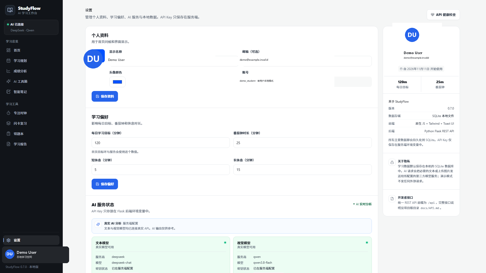
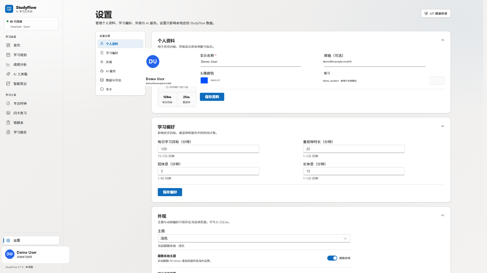
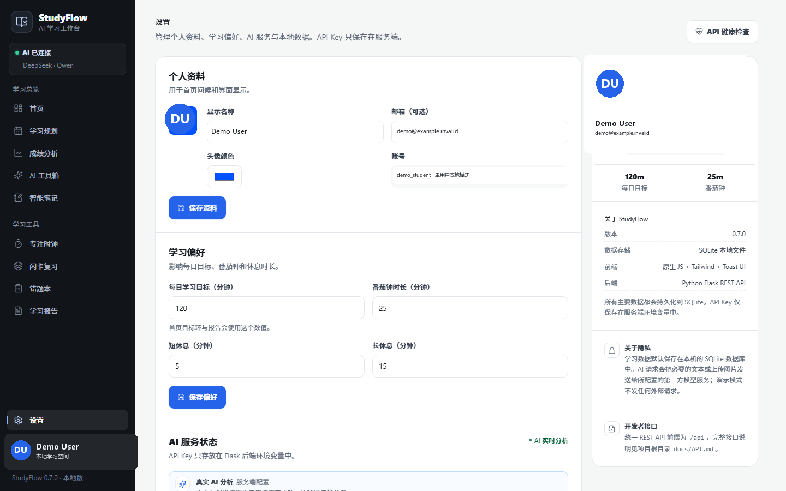
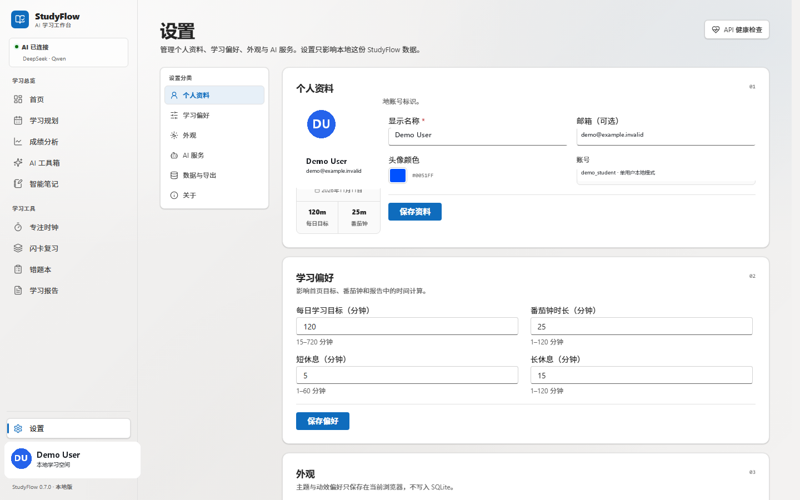
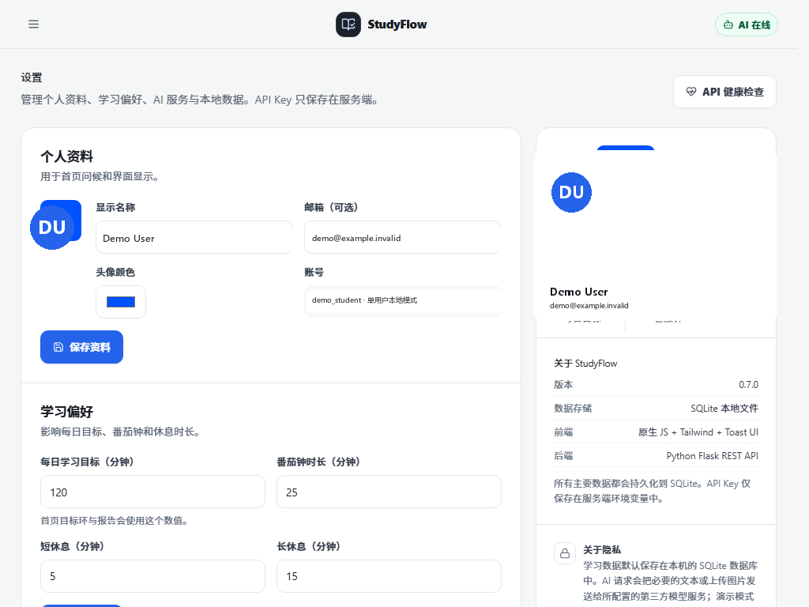
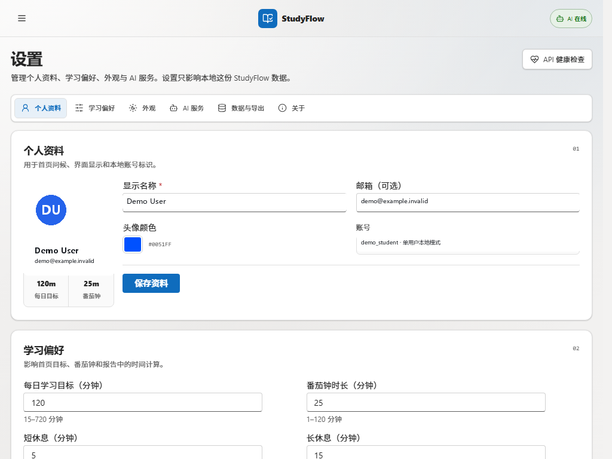
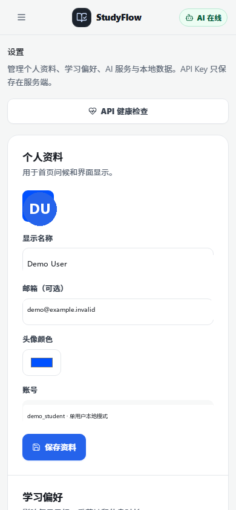
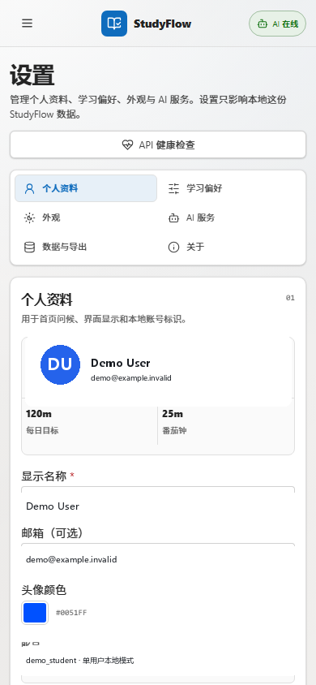

# Settings 页面 Fluent 迁移

状态：**Settings 迁移完成，等待验收。其余九个生产页面未改动。**

## 范围

本次只修改 Settings 页面及其按需加载的样式/组件资源：

- 保留 Flask、SQLite、所有 API 路径、请求体和响应结构。
- 保留原有 Settings 功能：资料保存、学习偏好保存、AI 服务状态、配置模板复制、演示数据载入/清除、数据导出、关于/隐私/开发者信息。
- 没有修改 `.env`、API Key、AI 调用逻辑、数据库结构或其他页面模块。
- 新增两个浏览器 UI 偏好：主题与减少动画。它们只写入 `localStorage`，不进入 SQLite/API。

## 迁移前后截图

### 1920 × 1080

| 迁移前 | 迁移后 |
| --- | --- |
|  |  |

### 1440 × 900

| 迁移前 | 迁移后 |
| --- | --- |
|  |  |

完整页面：

- [迁移前 1440 全页](screenshots/settings-before-1440-full.png)
- [迁移后 1440 全页](screenshots/settings-after-1440-full.png)

### 1024 × 768

| 迁移前 | 迁移后 |
| --- | --- |
|  |  |

### 390 × 844

| 迁移前 | 迁移后 |
| --- | --- |
|  |  |

完整页面：

- [迁移前 390 全页](screenshots/settings-before-390-full.png)
- [迁移后 390 全页](screenshots/settings-after-390-full.png)

### 深色主题与 Acrylic Dialog

- [1440 深色](screenshots/settings-after-dark-1440.png)
- [1440 深色全页](screenshots/settings-after-dark-1440-full.png)
- [390 深色](screenshots/settings-after-dark-390.png)
- [清除演示数据 Dialog](screenshots/settings-after-dialog-1440.png)

## 视觉与布局

- 完整页面使用 Fluent Mica 式背景：侧栏、移动端顶栏、页面底色分层；没有用背景模糊冒充 Mica。
- 内容使用白色/深色实色 surface，卡片统一 Fluent 8–12px 圆角和低对比度描边。
- Settings 页面加入页内分类导航：个人资料、学习偏好、外观、AI 服务、数据与导出、关于。
- 1440/1920：左侧设置分类 + 右侧分组内容。
- 1024：应用侧栏收起后，设置分类变为横向导航。
- 390：分类导航为两列紧凑网格，表单切换为单列，按钮全宽。
- Acrylic 用于 Dialog 和主题 Dropdown 的浮层；不支持 `backdrop-filter` 时回退为实色。

## Fluent 组件映射

| 能力 | Settings 中的实现 |
| --- | --- |
| Button | `fluent-button`：保存、载入/清除演示数据、复制配置、Dialog 操作 |
| Text Field | `fluent-text-input` + `fluent-field`：昵称、邮箱、四个学习时长 |
| Select | `fluent-dropdown` + `fluent-listbox` + `fluent-option`：主题 |
| Switch | `fluent-switch`：跟随系统主题 |
| Checkbox | `fluent-checkbox`：减少动画效果 |
| Tooltip | `fluent-tooltip`：API Key 保存位置说明，锚点为原生 button |
| Dialog | `fluent-dialog`：清除演示数据确认 |
| Native anchor | API 健康检查、JSON 导出，保留原有 URL 和下载行为 |
| Native color input | 头像颜色，保留原有任意颜色能力 |

## 重点问题处理

### Dropdown 默认值回填

Fluent v3.2.1 不会从 `value` attribute 自动回填。实现为：

1. 等待 `customElements.whenDefined("fluent-dropdown")`；
2. 等待 `dropdown.updateComplete`；
3. 等两个 animation frame；
4. 找到 option index；
5. 调用 `dropdown.selectOption(index, false)`。

这样不会触发额外的 `change`，也不会在 options 未连接时触发组件内部异常。验证结果：默认选中 `浅色`，手动选择 `深色` 后 `value = "dark"`。

### 表单提交

- 两个原有表单仍使用标准 `FormData` 和原有 `PUT /api/settings` payload。
- 浏览器测试实际提交了当前资料和偏好，并收到：
  - `资料已保存`
  - `偏好已保存`
- 没有修改测试值，避免覆盖用户数据；SQLite 的 `updated_at` 会因正常保存而更新。

### Checkbox / Switch 状态同步

- Fluent Checkbox/Switch 本身没有默认文本 slot，因此全部使用外部 `<label for>`。
- 主题 dropdown、跟随系统 Switch、减少动画 Checkbox 的初始状态来自浏览器偏好/系统偏好。
- 手动选择主题会自动关闭“跟随系统”，Switch 状态随之同步；重新开启会恢复系统主题并回填 dropdown。
- Checkbox 状态和 `sfl-reduce-motion` class 同步。
- Fluent 3.2.1 的主题没有提供 `--strokeWidthThin`，Checkbox 因此会渲染为 0px 边框；已在 Fluent token 层补上官方 Fluent 2 数值，并为 Settings 增加安全边框回退。

### Tooltip 键盘焦点

- 使用原生 `<button>` 作为 tooltip anchor，确保键盘可以聚焦；
- 额外监听 `focusin` / `focusout`，调用 Fluent Tooltip 的 `showTooltip()` / `hideTooltip()`；
- CDP 验证：`document.activeElement = sfl-api-help`，Tooltip `:popover-open = true`。

### 页面主题与 Fluent 主题

- `@fluentui/tokens` 的 `webLightTheme` / `webDarkTheme` 通过本地 `Fluent.setTheme()` 应用。
- 进入 Settings 时应用；离开 Settings 后保留全站 `data-theme`，由全站 Fluent shell 继承。
- 深色主题覆盖整个 Settings 页面外壳：侧栏、移动端顶栏、页面标题、所有 section、表单、页脚、Toast 和 Dialog。
- 主题/动效偏好保存在 `localStorage`，不调用 API、不写 SQLite。
- 主题由 Settings 控件管理，已经提升为全站主题；九个页面的迁移细节见 `docs/ALL_PAGES_FLUENT_MIGRATION.md`。

## CSS 冲突处理

- 所有新样式都放在 `settings-fluent.css`，并以 `body[data-route="settings"]` 或 `.sfl-*` 为作用域。
- Fluent CSS/JS 在 Settings 首次渲染时动态加载；Dashboard 初始加载不会下载 Fluent vendor 资源。
- `index.html` 没有添加全局 Fluent link，其他页面没有改动。
- 兼容旧样式时发现 `design-system.css` 用 `!important` 把 `.mobile-header` 背景设成 `--bg`；Settings 使用更高作用域的选择器覆盖，并保持 1181px 以上隐藏。
- 旧 Settings 选择器（`.settings-layout`、`.settings-card`、`.settings-main`、`.settings-side`）没有应用在新 DOM 上，没有删除旧 CSS，以免影响回滚。
- 已验证 Dashboard 不会产生 `fluent-*` DOM，也不会请求 Fluent CSS/JS。

## 测试结果

### 视图尺寸

| 尺寸 | 横向溢出 | 顶栏 |
| --- | --- | --- |
| 1920 × 1080 | 无 | 桌面侧栏 |
| 1440 × 900 | 无 | 桌面侧栏 |
| 1024 × 768 | 无 | 移动顶栏，设置分类横向 |
| 390 × 844 | 无 | 移动顶栏，两列分类 |
| 320 × 640（额外） | 无 | 移动顶栏 |

动态连续调整：

```text
1920 → 1440 → 1024 → 900 → 768 → 640 → 480 → 390 → 320
```

全部无水平溢出。

### 功能

- 资料保存：通过
- 学习偏好保存：通过
- 表单 FormData：通过（昵称、邮箱、头像色、四项偏好）
- Dropdown 默认值：通过
- Dropdown 手动切换：通过
- 跟随系统状态同步：通过
- Checkbox 状态同步：通过
- Tooltip 键盘焦点：通过
- 清除演示数据 Dialog 打开/取消：通过
- 分类导航滚动与 active 状态：通过
- API 健康检查链路：`GET /api/health` 200
- 数据导出链路：`GET /api/export` 200
- 配置模板复制：通过（剪贴板内容 323 字符）
- 主题持久化：通过
- 离开 Settings 后全站主题保留、Fluent DOM 不泄漏、reduce-motion 页面类清理：通过
- 其他 9 个页面 × 1440/390 共 20 次加载：通过
- 后端 pytest：**28 passed**

### 材质实测

- `.sidebar` / `.mobile-header` 的 `backdrop-filter`：`none`（Mica 不是模糊）
- 侧栏背景：分层 radial/linear 色场
- 主题 Dropdown：`rgba(252,252,252,0.78)` + `blur(24px) saturate(1.2)`
- Dialog：`rgba(252,252,252,0.78)` + `blur(28px) saturate(1.2)`
- Dialog actions：横向排列（`row`）
- 深色 Dialog：`rgba(44,44,44,0.80)` + `blur(28px) saturate(1.2)`

### 控制台与网络

- Console errors：0
- Uncaught exceptions：0
- Failed requests：0
- Dashboard / 其他页面未请求 Fluent vendor
- 未执行真实 AI 请求
- 未执行破坏性的“清除演示数据”确认；只验证 Dialog 打开/取消，以保护现有数据

## 修改文件清单

- `frontend/js/pages/settings.js`
- `frontend/css/settings-fluent.css`
- `frontend/css/fluent/studyflow-fluent-tokens.css`（补充 Fluent 2 stroke token）
- `docs/SETTINGS_FLUENT_MIGRATION.md`
- `docs/screenshots/settings-before-*.png`
- `docs/screenshots/settings-after-*.png`
- `README.md`（迁移状态说明）

未修改：

- 后端任何 `.py`
- `schema.sql`
- `.env`
- API 路由与 payload
- 其他 9 个页面模块/样式
- `index.html`
- 任何业务数据内容（表单测试提交的是原值；SQLite 的 `updated_at` 因正常保存而更新）

## 已知问题

1. **主题入口在 Settings，作用域已提升为全站**。Settings 仍是主题/跟随系统/减少动画的控制面板；离开 Settings 后主题会保留。九个页面迁移细节见 `docs/ALL_PAGES_FLUENT_MIGRATION.md`。
2. Fluent Web Components 预构建 bundle 包含全部 42 个组件，约 267 KB；Settings 首次进入会加载，尚未按组件 tree-shaking。
3. 浏览器验证目前只覆盖 Chrome 157；Edge/Firefox/Safari 尚未验证。
4. Fluent 的 Checkbox 在没有官方 `--strokeWidthThin` 时没有可见边框；当前使用 token 补偿 + Settings 作用域边框回退。
5. 实际“清除演示数据”和“载入演示数据”写操作未执行，以保护现有数据；只验证按钮/API 链路与 Dialog 取消路径。
6. 主题/减少动画偏好是浏览器本地设置，不会同步到其他设备。
7. 没有修改或删除旧 Settings CSS；后续删除旧样式前需要再做一轮回归。

## 启动

服务当前运行在 `http://127.0.0.1:5000`，直接访问：

```text
http://127.0.0.1:5000/#/settings
```

重启：

```powershell
cd studyflow
.\.venv\Scripts\python.exe run.py
```
